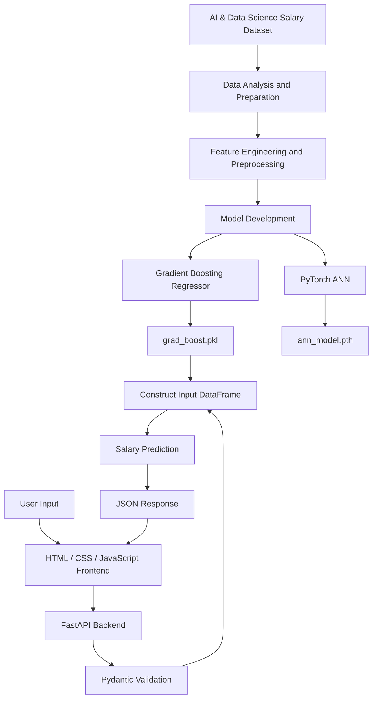

# 💼 AI & Data Science Salary Prediction
### An End-to-End Machine Learning Application for Salary Estimation

<p align="center">
  <a href="https://ai-ds-salary-prediction-ui-interface.onrender.com">
    
  </a>
  <a href="https://github.com/bikram-parth/AI_DS_SALARY_prediction">
    
  </a>
  <a href="https://ai-ds-salary-prediction-1.onrender.com/docs">
    
  </a>
</p>

<p align="center">
  
  
  
  
  
  
  
</p>

---

## 📌 Project Overview

**AI & Data Science Salary Prediction** is an end-to-end machine learning project designed to estimate salaries for professionals working in artificial intelligence, machine learning, data science, and related technology roles.

The project uses job-related, professional, and employment attributes to generate salary predictions through a trained regression model. It combines data science, traditional machine learning, deep learning, backend API development, and frontend integration in one application.

Rather than stopping at model training, I developed a web-based prediction system that allows users to submit professional details through a frontend and receive a model-generated salary estimate.

### ✨ Key Highlights

- 📊 Worked with an AI and Data Science job salary dataset for 2026.
- 🧹 Prepared data and processed categorical and numerical features.
- 🤖 Developed a Gradient Boosting regression model.
- 🧠 Included an Artificial Neural Network (ANN) model implemented with PyTorch.
- 💾 Saved trained models as reusable artifacts.
- ⚡ Built a REST API using FastAPI.
- 🛡️ Implemented input validation using Pydantic.
- 🌐 Developed a separate frontend using HTML, CSS, and JavaScript.
- 🔗 Integrated the frontend with the prediction API.
- ☁️ Deployed the application on Render.

---

## 🎯 Problem Statement

Salary estimation in AI and Data Science depends on several factors, including job role, professional experience, employment type, location, education, company characteristics, and additional professional attributes.

The goal of this project is to learn patterns from historical salary data and use them to estimate compensation for a given professional profile.

The project is formulated as a **supervised regression problem**, where the model learns a relationship between input features and a numerical salary target.

### Objectives

1. Explore and understand the job salary dataset.
2. Prepare input features for machine learning.
3. Develop and save regression models.
4. Accept structured professional information through an API.
5. Generate predictions using a trained model.
6. Connect the backend to an interactive web interface.
7. Deploy the application so users can access it online.

---

## 🌐 Live Application

<text>**Try the application:**</text>

[Open AI & Data Science Salary Predictor](https://ai-ds-salary-prediction-ui-interface.onrender.com)

The application uses a separate frontend and backend architecture.

| Component | Link |
|---|---|
| Web application | [Open frontend](https://ai-ds-salary-prediction-ui-interface.onrender.com) |
| FastAPI backend | [Open backend](https://ai-ds-salary-prediction-1.onrender.com) |
| Interactive API documentation | [Open Swagger UI](https://ai-ds-salary-prediction-1.onrender.com/docs) |
| Source code | [GitHub repository](https://github.com/bikram-parth/AI_DS_SALARY_prediction) |
| Dataset | [Kaggle dataset](https://www.kaggle.com/datasets/uditjain13/ai-and-data-science-job-salaries-2026) |

*The links identify the configured deployment addresses; live availability may vary.*

---

## 🏗️ System Architecture

The application follows a straightforward machine learning deployment workflow.



### How it works

1. **Data preparation:** The dataset is explored and prepared for supervised learning.
2. **Model development:** Regression approaches are used to learn relationships between job characteristics and salary.
3. **Model persistence:** The trained Gradient Boosting model is stored in `grad_boost.pkl`. The repository also contains a PyTorch model artifact, `ann_model.pth`.
4. **User interaction:** The frontend collects information about a professional profile.
5. **API communication:** JavaScript sends the input data to the FastAPI backend.
6. **Input validation:** Pydantic checks that the incoming data matches the defined schema.
7. **Prediction:** The backend constructs a Pandas DataFrame and passes it to the loaded Gradient Boosting model.
8. **Response:** The predicted salary is returned as a structured response that the frontend can display.

---

## 📊 Dataset Description

The project uses the following Kaggle dataset:

**AI and Data Science Job Salaries 2026**

Dataset: [Udit Jain — AI and Data Science Job Salaries 2026](https://www.kaggle.com/datasets/uditjain13/ai-and-data-science-job-salaries-2026)

The dataset provides job and professional attributes that can be used to investigate salary patterns across different roles and employment conditions.

### Feature engineering and input attributes

The deployed API accepts **22 input features**, grouped into the following categories.

| Category | Features |
|---|---|
| Job information | `job_title`, `experience_level`, `employment_type` |
| Employer and geography | `company_size`, `company_location`, `employee_residence`, `industry` |
| Professional background | `years_experience`, `education_level`, `primary_language`, `certifications_count` |
| Responsibilities and working habits | `has_ml_in_title`, `manages_people`, `weekly_hours`, `uses_ai_tools_daily` |
| Compensation-related attributes | `salary_currency`, `equity_offered_pct`, `bonus_pct` |
| Additional professional attributes | `job_satisfaction_score`, `interviews_to_offer`, `switched_jobs_last_year`, `fears_ai_automation_score` |

The API's target output is `salary_usd`, representing the salary estimate in USD as defined by the prediction response schema.

The input feature `salary_currency` is supplied separately as part of the professional profile. The meaning and currency conversion behavior of the training target should be understood from the notebook and dataset before interpreting predictions across countries.

---

## 🔬 Machine Learning Workflow

### 1. Data exploration

The first stage is understanding the dataset and identifying the variables that may help explain salary variation.

Typical analysis areas include:

- Inspecting the dataset structure and data types.
- Understanding numerical feature distributions.
- Examining categorical feature values.
- Exploring salary patterns across job roles and experience levels.
- Investigating relationships between professional attributes and compensation.
- Checking data quality before model development.

Pandas and NumPy provide the foundation for data manipulation, while visualization tools can help reveal distributions and relationships.

### 2. Data preprocessing

Raw data must be represented consistently before it can be passed to a regression algorithm.

This project involves working with numerical and categorical features. Categorical fields include job title, employment type, experience level, education, company location, and industry.

The preprocessing workflow should ensure that training data and prediction data use compatible feature representations and column ordering.

### 3. Feature preparation

The project incorporates a range of professional characteristics instead of relying only on job title or years of experience.

For example, the model input includes:

- Professional seniority and years of experience.
- Educational background and certifications.
- Industry and geographical information.
- Working hours and people-management responsibilities.
- Bonus and equity-related information.
- Additional self-reported professional attributes.

These features provide a broader representation of a professional profile. Their actual predictive value depends on the dataset, model training, and evaluation results.

### 4. Gradient Boosting Regressor

The deployed application loads the trained Gradient Boosting model from:

```text
grad_boost.pkl
```

Gradient Boosting is an ensemble learning technique that combines multiple decision trees in a sequential learning process.

Each new tree attempts to improve the predictions made by the existing ensemble, allowing the model to capture nonlinear relationships and interactions between input features.

A simplified prediction can be expressed as:

\[
\hat{y}(x)=F_0(x)+\sum_{m=1}^{M}\eta h_m(x)
\]

Where:

- \(\hat{y}(x)\) is the predicted salary.
- \(F_0(x)\) is the initial model.
- \(h_m(x)\) represents a successive tree's contribution.
- \(\eta\) is the learning rate.
- \(M\) is the number of boosting stages.

This model is the one explicitly loaded and used by the current FastAPI prediction endpoint.

### 5. Artificial Neural Network (ANN)

The repository also contains:

```text
ann_model.pth
```

This is a PyTorch model artifact associated with the project's neural-network work.

An ANN learns relationships through layers of interconnected neurons. During training, the network adjusts its parameters to reduce a loss function.

A typical fully connected layer is represented as:

\[
a=\sigma(Wx+b)
\]

Where \(x\) is the input, \(W\) is the weight matrix, \(b\) is the bias, and \(\sigma\) is the activation function.

Developing both traditional machine learning and deep learning models provides an opportunity to study different approaches to regression. The existence of the ANN artifact does not mean it is currently served by the deployed API; `app.py` loads `grad_boost.pkl`.

---

## 💾 Model Serialization

Trained models need to be stored so that an application can reuse them without retraining for every request.

### Gradient Boosting model

The backend loads the model using Joblib:

```python
import joblib

model = joblib.load("grad_boost.pkl")
```

The loaded estimator can then generate predictions for new inputs.

### PyTorch ANN model

The repository also includes `ann_model.pth`, a PyTorch artifact. The correct loading procedure depends on whether the artifact stores a model's state dictionary or a serialized model object and on the model architecture used during training.

Keeping model artifacts in the repository makes the trained models accessible to the project, but their runtime use depends on the application code.

---

## ⚡ Backend Development with FastAPI

FastAPI exposes the trained model through HTTP endpoints.

### API endpoints

| Method | Endpoint | Purpose |
|---|---|---|
| `GET` | `/` | Returns a welcome message |
| `POST` | `/predict` | Validates professional information and predicts salary |

### Request validation with Pydantic

The API defines an `aids_salary_data` model using Pydantic's `BaseModel`.

This schema specifies the accepted values and constraints for all 22 input features.

Examples include:

- `job_title` must match one of the supported job roles.
- `experience_level` must match an allowed seniority category.
- `employment_type` must match an accepted employment type.
- `years_experience` must be between 0 and 24.
- `certifications_count` must be between 0 and 9.
- `weekly_hours` must be between 24 and 67.
- Boolean attributes must be supplied as actual Boolean values.
- Equity, bonus, satisfaction, and other numeric inputs must satisfy their defined bounds.

These checks help ensure that the prediction endpoint receives structured data in the expected format.

### Prediction logic

The backend converts the validated request into a Pandas DataFrame, with columns matching the model's expected input features.

The prediction is generated using:

```python
prediction = model.predict(input_df)[0]
```

The backend returns a response using the `prediction_response` schema:

```json
{
  "salary_usd": 125000.0
}
```

*The salary shown above is an illustrative example, not a measured project result.*

### CORS configuration

The backend includes CORS middleware so that a separately hosted frontend can send requests to the API.

For a production application, allowed origins should be restricted to the trusted frontend domain rather than using a wildcard configuration.

---

## 🎨 Frontend Development

The frontend is built with HTML, CSS, and JavaScript and is hosted separately from the API.

| Technology | Purpose |
|---|---|
| HTML5 | Structures the input form and output area |
| CSS3 | Controls styling and layout |
| JavaScript | Collects inputs, sends HTTP requests, and processes responses |

### Frontend workflow

- Collect information about the job and professional profile.
- Convert form inputs into the expected request format.
- Send a `POST` request to the backend's `/predict` endpoint.
- Parse the returned JSON response.
- Display the predicted salary to the user.

The separate frontend and backend architecture keeps user interaction independent of the model implementation and makes the system easier to maintain.

---

## ☁️ Deployment on Render

The application is deployed using Render, with separate services for the frontend and backend.

### Deployment architecture

| Service | Responsibility |
|---|---|
| Render Static Site | Hosts the HTML, CSS, and JavaScript frontend |
| Render Web Service | Runs the FastAPI prediction backend |

The frontend communicates with the backend through its public API URL.

### Backend startup

For a Render Web Service, the Uvicorn start command can be configured as:

```bash
uvicorn app:app --host 0.0.0.0 --port $PORT
```

The backend's Python dependencies are listed in `requirements.txt`.

### Deployment considerations

- Install dependencies using `pip install -r requirements.txt`.
- Ensure that `grad_boost.pkl` is included in the backend's deployment environment.
- Keep the scikit-learn version compatible with the version used to serialize the model.
- Configure the frontend to use the correct backend URL.
- Allow the frontend origin in the backend's CORS configuration.
- Test the `/predict` endpoint using Swagger UI after deployment.

---

## 🛠️ Technology Stack

| Category | Technologies |
|---|---|
| Programming language | Python |
| Data processing | Pandas, NumPy |
| Traditional machine learning | Scikit-learn |
| Deep learning | PyTorch |
| Model serialization | Joblib |
| Backend framework | FastAPI |
| Data validation | Pydantic |
| ASGI server | Uvicorn |
| Frontend | HTML5, CSS3, JavaScript |
| Development environment | Jupyter Notebook |
| Version control | Git, GitHub |
| Cloud deployment | Render |

---

## 📁 Repository Structure

```text
AI_DS_SALARY_prediction/
│
├── ai_ds_job_salaries_2026.csv
│   └── Dataset used for salary analysis and modelling
│
├── project1.ipynb
│   └── Notebook for data analysis and model development
│
├── grad_boost.pkl
│   └── Saved Gradient Boosting model used by the API
│
├── ann_model.pth
│   └── PyTorch ANN model artifact
│
├── app.py
│   └── FastAPI application and prediction endpoint
│
├── index.html
│   └── Frontend page
│
├── style.css
│   └── Frontend styling
│
├── script.js
│   └── Frontend interaction and API communication
│
├── requirements.txt
│   └── Python dependencies
│
└── README.md
    └── Project documentation
```

---

## 🚀 Run the Project Locally

### Prerequisites

- Python installed on your system.
- Git.
- A compatible Python environment for the saved scikit-learn model.

### Step 1: Clone the repository

```bash
git clone https://github.com/bikram-parth/AI_DS_SALARY_prediction.git
```

### Step 2: Enter the project directory

```bash
cd AI_DS_SALARY_prediction
```

### Step 3: Create a virtual environment

**Windows:**

```bash
python -m venv venv
venv\Scripts\activate
```

**macOS / Linux:**

```bash
python3 -m venv venv
source venv/bin/activate
```

### Step 4: Install dependencies

```bash
pip install -r requirements.txt
```

The repository's requirements include FastAPI, Uvicorn, Pydantic, Joblib, Pandas, NumPy, and Scikit-learn 1.8.0.

### Step 5: Start the backend

```bash
uvicorn app:app --reload
```

The backend will be available at:

```text
http://127.0.0.1:8000
```

Open the interactive API documentation at:

```text
http://127.0.0.1:8000/docs
```

### Step 6: Open the frontend

Open `index.html` in a browser or serve it using a local static web server.

Ensure that `script.js` points to the correct local backend address and sends requests to `/predict`.

---

## 🧪 Example API Request

The following example illustrates the structure expected by the prediction endpoint.

```json
{
  "job_title": "Machine Learning Engineer",
  "experience_level": "Senior",
  "employment_type": "Full-time",
  "company_size": "M",
  "company_location": "IN",
  "employee_residence": "IN",
  "industry": "Technology",
  "years_experience": 5,
  "education_level": "Masters",
  "primary_language": "Python",
  "has_ml_in_title": true,
  "manages_people": false,
  "certifications_count": 3,
  "weekly_hours": 40,
  "uses_ai_tools_daily": true,
  "salary_currency": "INR",
  "equity_offered_pct": 0.1,
  "bonus_pct": 10,
  "job_satisfaction_score": 8,
  "interviews_to_offer": 3,
  "switched_jobs_last_year": false,
  "fears_ai_automation_score": 5
}
```

Send this JSON as the body of a `POST` request to:

```text
http://127.0.0.1:8000/predict
```

The API responds with a JSON object containing `salary_usd`.

The values above are an illustrative request and must be adjusted to reflect the feature ranges and categories used by the deployed model.

---

## 🧠 Key Learning Outcomes

This project demonstrates practical experience with several parts of the machine learning lifecycle.

- **Supervised learning:** Formulating salary estimation as a regression task.
- **Feature preparation:** Working with mixed numerical and categorical data.
- **Ensemble learning:** Using a Gradient Boosting Regressor for prediction.
- **Deep learning:** Working with a PyTorch ANN model.
- **Model persistence:** Saving and loading trained model artifacts.
- **API development:** Exposing a machine learning estimator through FastAPI.
- **Input validation:** Defining typed schemas and numerical constraints with Pydantic.
- **Frontend–backend integration:** Connecting JavaScript to a Python prediction service.
- **Deployment:** Making the application accessible through Render.
- **Model compatibility:** Managing dependencies and serialized model versions.

The central learning outcome is the transition from developing machine learning models in a notebook to integrating a trained estimator into an accessible web application.

---

## 🔮 Future Improvements

Potential enhancements for the project include:

- Compare regression models using consistent training and test splits.
- Publish verified MAE, RMSE, and \(R^2\) results.
- Evaluate the ANN and Gradient Boosting models on the same held-out test data.
- Use a unified preprocessing pipeline for training and inference.
- Add automated API tests and input-validation tests.
- Improve error handling and frontend loading states.
- Restrict CORS to trusted domains.
- Add feature-importance analysis to help explain salary predictions.
- Evaluate model performance across job roles, experience levels, and geographical groups.
- Add automated deployment checks and model-version tracking.

---

## ⚠️ Limitations

This project is an educational machine learning application, not a guaranteed salary benchmark.

Predictions depend on the historical dataset, the feature distributions seen during training, the quality of input information, and the model's generalization performance. Actual compensation can differ substantially because of market conditions, negotiation, company policies, location, and other factors.

The model's predictive performance should be assessed using held-out data before its estimates are relied upon for professional or financial decisions.

---

## 👨‍💻 Author

**Bikram Debnath**

B.Tech — Computer Science and Engineering (Artificial Intelligence and Machine Learning)

Interested in Machine Learning, Deep Learning, Data Science, and building deployable AI applications.

- **GitHub:** [bikram-parth](https://github.com/bikram-parth)
- **Project Repository:** [AI_DS_SALARY_prediction](https://github.com/bikram-parth/AI_DS_SALARY_prediction)
- **Live Application:** [AI & Data Science Salary Predictor](https://ai-ds-salary-prediction-ui-interface.onrender.com)

---

<p align="center">
  <b>Turning machine learning experiments into practical, deployable applications.</b>
</p>


